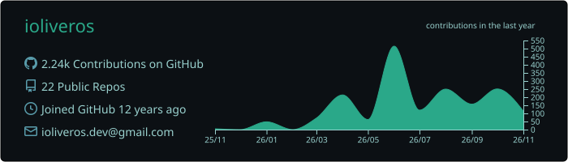
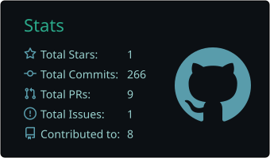
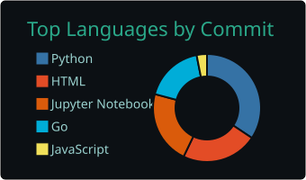

<h1 align="center">Hey, I'm Ian 👨‍🚀</h1>

  
  
  

---

### 🛰️ About me

- 👨‍💻 senior software engineer by trade, electronics engineer by degree (and a few soldering burns)
- 🔧 if it has screws, i’ve opened it. if it doesn’t, i’ve tried
- 🛡️ into cybersecurity, because breaking things is half the fun
- 📈 still nerding out on big data and classic ml, from back when models fit on a laptop
- 🤖 building rag pipelines and mcp systems, exploring generative ui. basically teaching robots to read the docs
- 💰 always hunting fresh intergalactic bounties. got one? let’s collab!
- 🧑‍🌾 learning to grow potatoes, as a backup plan for the ai apocalypse

---

### 🧰 Tech stack

  
  
  
  
  
  
  
   
  
  
  
  
  
  
  
   
  
  
  
  
  
  
   
  
  
  
  
  
  
   
  
  
  
  
  
   
  
  
  

---

### 📊 GitHub stats

  

  
  

  

---

### 🎯 Open for bounties

  

  Got an interesting problem, side project, or contract?  
  Slide into my DMs or drop me a line at <a href="mailto:ioliveros.dev@gmail.com"><b>ioliveros.dev@gmail.com</b></a> 👨‍🚀

